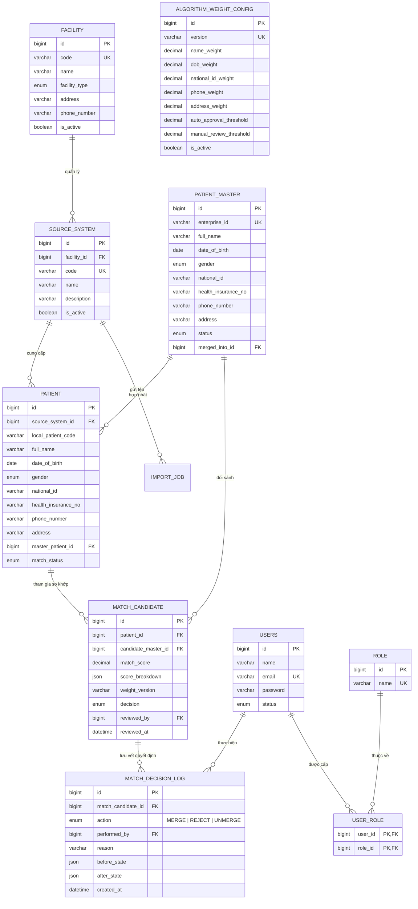

# 🏥 VITALIS MPI — Master Patient Index System
### Hệ Thống Quản Lý Định Danh & Hợp Nhất Hồ Sơ Bệnh Nhân Toàn Quốc

[](https://openjdk.org/)
[](https://spring.io/projects/spring-boot)
[](https://angular.dev/)
[](https://www.mysql.com/)
[](#)

---

## 📖 1. Giới thiệu Dự Án

Trong các cơ sở y tế phân tán (Bệnh viện đa khoa, Bệnh viện chuyên khoa, Phòng khám, Trung tâm xét nghiệm), mỗi đơn vị sử dụng một hệ thống phần mềm riêng biệt (HIS, LIS, RIS, PACS, EMR) và cấp cho bệnh nhân một mã bệnh nhân cục bộ riêng (`local_patient_code`). Khi người dân đi khám liên viện hoặc dữ liệu biến động (sai lệch dấu tiếng Việt, viết tắt họ tên, thay đổi CCCD/CMND, số thẻ BHYT, số điện thoại, địa chỉ), hồ sơ y tế bị phân mảnh nghiêm trọng.

**Vitalis MPI (Master Patient Index)** là nền tảng cốt lõi giải quyết bài toán:
- **Hợp nhất hồ sơ bệnh nhân:** Tự động phát hiện trùng lặp từ nhiều nguồn bệnh viện và gộp về một **Hồ sơ Gốc duy nhất (Golden Record)** với mã định danh toàn quốc duy nhất (`Enterprise ID - EID`).
- **Thuật toán so khớp thông minh (Probabilistic Matching Engine):** Chấm điểm tương đồng dựa trên trọng số các trường nhân khẩu học (Họ tên, Ngày sinh, Giới tính, CCCD, BHYT, SĐT, Địa chỉ).
- **Hàng đợi phê duyệt linh hoạt (Review Queue):** Các ca nghi vấn trong khoảng ngưỡng cho phép được đưa vào hàng đợi để chuyên viên dữ liệu (`REVIEWER`) đối chiếu trực quan 2 bên (Side-by-side Comparison) và ra quyết định duyệt gộp (`MERGE`) hoặc tách riêng (`REJECT`).
- **Nhật ký kiểm toán minh bạch (Audit Trail):** Toàn bộ lịch sử gộp, tách, cập nhật thông tin đều được ghi nhận vào bảng `match_decision_log`.
- **Nhập dữ liệu hàng loạt bất đồng bộ (Async Batch Import):** Tiếp nhận các tệp Excel (`.xlsx`) hoặc `.csv` dung lượng lớn (lên tới 500MB), tự động ánh xạ cột và xử lý luồng ngầm không gây nghẽn hệ thống.

---

## 🏗️ 2. Kiến Trúc & Công Nghệ

```
                                      ┌─────────────────────────────────────────────────────────┐
                                      │                   VITALIS CLIENT UI                     │
                                      │   Angular 18 Standalone + Signals + Pure CSS Variables  │
                                      └────────────────────────────┬────────────────────────────┘
                                                                   │ HTTP / RESTful (OAuth2 JWT)
                                                                   ▼
┌────────────────────────────────────────────────────────────────────────────────────────────────────────────────────────┐
│                                              SPRING BOOT BACKEND ENGINE                                                │
│                                                                                                                        │
│  ┌───────────────────────┐  ┌────────────────────────┐  ┌────────────────────────┐  ┌───────────────────────────────┐ │
│  │    AuthController     │  │  PatientMasterController│  │  ReviewQueueController │  │       ImportController        │ │
│  │ (JWT + Refresh Cookie)│  │ (Golden Records + Audit)│  │(Manual Review Decisions│  │(Async POI/OpenCSV Orchestrator│ │
│  └───────────────────────┘  └────────────────────────┘  └────────────────────────┘  └───────────────────────────────┘ │
│                                                                                                                        │
│  ┌──────────────────────────────────────────────────────────────────────────────────────────────────────────────────┐  │
│  │                                          MATCHING & DEDUPLICATION CORE                                           │  │
│  │     - Levenshtein Distance & Text Normalizer           - Dynamic Weighted Algorithm Config (Versioning)           │  │
│  │     - Blocking Strategies (DOB + First3Chars / Phone)  - Auto-Approval Threshold vs Manual-Review Threshold      │  │
│  └──────────────────────────────────────────────────────────────────────────────────────────────────────────────────┘  │
│                                                                                                                        │
│  ┌──────────────────────────────────────────────────────────────────────────────────────────────────────────────────┐  │
│  │                                                SPRING DATA JPA LAYER                                             │  │
│  │      Hibernate ORM  •  HikariCP Connection Pool  •  Spring TaskExecutor ThreadPool (@Async Ingestion)            │  │
│  └──────────────────────────────────────────────────────────────────────────────────────────────────────────────────┘  │
└──────────────────────────────────────────────────────────┬─────────────────────────────────────────────────────────────┘
                                                           │ JDBC (MySQL 8.x)
                                                           ▼
                                      ┌─────────────────────────────────────────────────────────┐
                                      │                   DATABASE: mpi_system                  │
                                      │   patient_master • patient • match_candidate • logs...   │
                                      └─────────────────────────────────────────────────────────┘
```

### 💻 Stack Công Nghệ Chi Tiết

| Tầng (Layer) | Công nghệ / Thư viện | Vai trò |
|---|---|---|
| **Backend Framework** | **Java 21/25**, **Spring Boot 3.x / 4.x** | Khung kiến trúc ứng dụng phía máy chủ |
| **Bảo mật (Security)** | **Spring Security**, **OAuth2 Resource Server**, **JWT** | Xác thực Token, HttpOnly Cookie Refresh Token, Session Invalidation |
| **ORM & Database** | **Spring Data JPA**, **Hibernate**, **MySQL 8.0+** | Quản lý thực thể, truy vấn cơ sở dữ liệu và ràng buộc toàn vẹn |
| **Xử lý tệp & Batch** | **Apache POI 5.2.5**, **OpenCSV 5.9** | Đọc và nạp dữ liệu hàng loạt từ tệp `.xlsx` và `.csv` siêu tốc |
| **Tài liệu API** | **Springdoc OpenAPI 3.1.0 (Swagger UI)** | Tự động sinh tài liệu API trực quan (`/swagger-ui.html`) |
| **Frontend Framework**| **Angular 18.x** | Single Page Application kiến trúc Standalone Components |
| **Quản lý Trạng thái**| **Angular Signals**, **RxJS 7.8** | Quản lý phản ứng (Reactive) và hiệu năng render tối ưu |
| **Giao diện & UI/UX** | **Vitalis Healthcare Design Tokens** (Pure CSS) | Tuyệt đối không dùng Tailwind; CSS variables chuẩn màu y tế cao cấp |
| **Biểu tượng & Font** | **Material Symbols Outlined**, **Font Manrope** | Bộ icon và typography hiện đại, rõ ràng |

---

## 🧩 3. Các Phân Hệ Chức Năng Chính

```
  mpi-web (Hệ Thống Quản Trị)
  ├── 1. Dashboard (Trung tâm Chỉ huy Giám sát MPI)
  ├── 2. Bệnh nhân Nguồn (Source Patients)
  ├── 3. Hồ sơ Gốc Định danh (Golden Records / Patient Masters)
  │      └── Chi tiết hồ sơ & Lịch sử biến động thực tế (MatchDecisionLog)
  ├── 4. Hàng đợi Duyệt Trùng lặp (Review Queue)
  │      └── So sánh hồ sơ trực quan (Side-by-side Compare & Merge/Reject)
  ├── 5. Nhập Dữ liệu Bệnh nhân (Batch Patient Import)
  │      └── Tải tệp, Ánh xạ cột, Xử lý ngầm Async, Giám sát tiến độ & Retry
  ├── 6. Cấu hình Trọng số Thuật toán (Algorithm Weight Config)
  │      └── Cấu hình tỷ lệ % từng trường & Ngưỡng duyệt tự động/thủ công
  ├── 7. Quản lý Cơ sở Y tế & Hệ thống Nguồn (Facilities & Source Systems)
  ├── 8. Quản trị Tài khoản & Phân quyền (Users & Roles)
  └── 9. Hồ sơ Cá nhân & Đổi mật khẩu Bảo mật (/profile)
```

### 1. Quản lý Hồ sơ Gốc (Golden Records - `patient_master`)
- Quản lý danh sách các hồ sơ bệnh nhân chuẩn hóa duy nhất với mã `Enterprise ID (EID)`.
- **Màn hình chi tiết hồ sơ gốc ([`patient-master-detail-page`](file:///c:/Users/ASUS/Downloads/mpi-web/mpi-web/fe/src/app/features/patient-master/pages/patient-master-detail-page)):**
  - Thông tin định danh: Họ tên, Ngày sinh, Giới tính, Số CCCD/CMND, Số thẻ BHYT, SĐT, Địa chỉ.
  - Thống kê tỷ lệ tin cậy (Confidence Score %).
  - Danh sách hồ sơ nguồn liên kết từ các bệnh viện kèm mã bệnh nhân cục bộ (`local_patient_code`).
  - **Lịch sử Biến động Hồ sơ (Timeline Audit Trail):** Hiển thị 100% dữ liệu thật từ bảng `match_decision_log`: Khởi tạo ban đầu, Tự động gộp (`AUTO_MERGE`), Gộp thủ công (`MANUAL_MERGE`), Cập nhật thủ công (`MANUAL_EDIT`), Tách hồ sơ (`UNMERGE`).
  - Cập nhật thông tin hồ sơ gốc nhanh chóng qua modal chỉnh sửa.

### 2. Thuật toán So Khớp & Hàng đợi Duyệt (Matching Engine & Review Queue)
- **Cơ chế Blocking:** Thuật toán lọc tập ứng viên tiềm năng bằng ngày sinh + 3 ký tự đầu họ tên hoặc 4 số cuối điện thoại hoặc CCCD để tránh so khớp toàn bộ DB ($O(N)$).
- **Chấm điểm Levenshtein:** Chuẩn hóa chuỗi tiếng Việt (loại bỏ dấu), tính khoảng cách tương đồng giữa chuỗi họ tên, địa chỉ.
- **Phân loại quyết định:**
  - `Match Score >= auto_approval_threshold` (mặc định $\ge 92\%$): **Tự động gộp (`AUTO_APPROVED`)**.
  - `manual_review_threshold <= Match Score < auto_approval_threshold` ($65\% - 91\%$): Đưa vào **Hàng đợi duyệt (`PENDING`)**.
  - `Match Score < manual_review_threshold`: Tạo hồ sơ gốc mới (`NEW_MASTER`).
- **Màn hình Đối soát So sánh ([`review-queue-compare-page`](file:///c:/Users/ASUS/Downloads/mpi-web/mpi-web/fe/src/app/features/review-queue/pages/review-queue-compare-page)):** Đặt 2 hồ sơ nguồn và hồ sơ Master cạnh nhau, highlight từng trường trùng hoặc khác biệt, cho phép Reviewer bấm **"Duyệt gộp"** hoặc **"Từ chối"** kèm lý do.

### 3. Nạp Dữ Liệu Hàng Loạt Bất Đồng Bộ (Batch Import Workflow)
- **Tải lên & Validation:** Tiếp nhận file Excel/CSV, kiểm tra định dạng tệp, cấu trúc dòng/cột.
- **Ánh xạ cột (Mapping):** Tự động phát hiện và cho phép người dùng ánh xạ cột trong file vào các trường chuẩn của hệ thống MPI.
- **Orchestration & Background Thread:** Đẩy luồng xử lý sang `@Async("importTaskExecutor")` với transaction tách biệt (`@Transactional(propagation = NEVER)`), cập nhật trạng thái chi tiết theo thời gian thực: `PENDING` $\rightarrow$ `PROCESSING` $\rightarrow$ `COMPLETED` / `FAILED`.
- **Giám sát & Khắc phục:** Cho phép xem từng dòng lỗi, retry các dòng thất bại hoặc hủy tiến trình đang chạy.

### 4. Quản trị Người Dùng & Hồ Sơ Cá Nhân
- Quản lý tài khoản với các vai trò: `ADMIN`, `REVIEWER`, `VIEWER`, `USER`.
- Thêm mới tài khoản tự động gán mật khẩu mặc định an toàn (`12345678`).
- Màn hình cá nhân ([`/profile`](file:///c:/Users/ASUS/Downloads/mpi-web/mpi-web/fe/src/app/features/user/pages/user-profile-page)): Thiết kế chuẩn Bento Card với thông tin định danh, các vai trò được cấp, trạng thái bảo mật chuẩn HIPAA, tính năng **Đổi mật khẩu** (mã hóa BCrypt).

---

## 🗄️ 4. Sơ Đồ Cơ Sở Dữ Liệu (`mpi_system`)



---

## 📁 5. Cấu Trúc Thư Mục Dự Án

```
mpi-web/
├── be/mpi/demo/                        # BACKEND (Spring Boot)
│   ├── src/main/java/com/mpi/demo/
│   │   ├── config/                     # SecurityConfig, JwtConfig, AsyncConfig, CorsConfig
│   │   ├── constant/                   # MatchDecisionEnum, MatchActionEnum, ImportRowStatusEnum...
│   │   ├── controller/                 # Auth, PatientMaster, ReviewQueue, Import, User...
│   │   ├── dto/
│   │   │   ├── request/                # CreatePatientRequest, ReviewDecisionRequest, ChangePasswordRequest...
│   │   │   └── response/               # PatientMasterResponse, PatientMasterHistoryResponse...
│   │   ├── entity/                     # PatientMaster, Patient, MatchCandidate, MatchDecisionLog, User...
│   │   ├── exception/                  # GlobalExceptionHandler, ResourceNotFoundException...
│   │   ├── repository/                 # Spring Data JPA Repositories
│   │   ├── service/                    # Business Interfaces & Service Implementations
│   │   │   └── impl/                   # PatientMatchingServiceImpl, AsyncImportProcessorImpl...
│   │   └── specification/              # JPA Specifications dynamic filter
│   ├── src/main/resources/
│   │   ├── application.yaml            # MySQL connection, JWT secrets, thresholds
│   │   └── db/migration/db.sql         # DDL Schema cơ sở dữ liệu
│   └── pom.xml                         # Maven dependencies & plugins
│
├── fe/                                 # FRONTEND (Angular 18)
│   ├── src/
│   │   ├── app/
│   │   │   ├── core/                   # Interceptors (JWT auth), Guards (authGuard, noAuthGuard)
│   │   │   ├── layout/                 # Header, Sidebar, App Shell
│   │   │   ├── shared/                 # ToastService, Pagination, ConfirmDialog, Validators, Enums
│   │   │   └── features/
│   │   │       ├── auth/               # Login page & Auth service
│   │   │       ├── patient/            # Danh sách hồ sơ bệnh nhân nguồn
│   │   │       ├── patient-master/     # Quản lý hồ sơ gốc & Chi tiết + Lịch sử biến động
│   │   │       ├── review-queue/       # Hàng đợi duyệt & Màn hình so sánh đối soát
│   │   │       ├── patient-import/     # Nạp dữ liệu Excel/CSV hàng loạt
│   │   │       ├── algorithm-config/   # Cấu hình trọng số thuật toán
│   │   │       ├── facility/           # Quản lý cơ sở y tế
│   │   │       ├── source-system/      # Quản lý hệ thống nguồn HIS/LIS
│   │   │       ├── user/               # Quản lý người dùng & Trang /profile cá nhân
│   │   │       └── dashboard/          # Trang tổng quan KPI
│   │   ├── environments/               # environment.ts (apiUrl: http://localhost:8080/api/v1)
│   │   └── styles.css                  # Toàn bộ CSS Variables hệ thống (Pure CSS)
│   └── package.json                    # Angular scripts & dependencies
│
├── DASHBOARD_SPECIFICATION.md          # Tài liệu đặc tả Dashboard chi tiết (KPI, Chart, Mock Data)
├── IMPORT_WORKFLOW.md                  # Tài liệu chi tiết luồng Import & Matching Engine
└── README.md                           # Tài liệu tổng quan dự án (File hiện tại)
```

---

## 🚀 6. Hướng Dẫn Cài Đặt & Chạy Dự Án

### Yêu cầu tiên quyết (Prerequisites)
- **Java:** JDK 17 hoặc 21+ (Khuyến nghị Java 21 LTS).
- **Node.js:** Node.js v18.x trở lên & npm v9+.
- **Database:** MySQL Server 8.0+.
- **Build tool:** Apache Maven (hoặc dùng `mvnw` wrapper đi kèm).

---

### Bước 1: Khởi tạo Cơ sở Dữ liệu (MySQL)
1. Mở MySQL Client / Workbench và tạo database:
   ```sql
   CREATE DATABASE `mpi_system` CHARACTER SET utf8mb4 COLLATE utf8mb4_unicode_ci;
   ```
2. Thực thi toàn bộ script tạo bảng từ file:
   ```text
   be/mpi/demo/src/main/resources/db/migration/db.sql
   ```

---

### Bước 2: Cấu hình và Khởi động Backend (Spring Boot)

1. Mở file cấu hình [`be/mpi/demo/src/main/resources/application.yaml`](file:///c:/Users/ASUS/Downloads/mpi-web/mpi-web/be/mpi/demo/src/main/resources/application.yaml) và điều chỉnh thông tin kết nối MySQL:
   ```yaml
   spring:
     datasource:
       url: jdbc:mysql://localhost:3306/mpi_system?allowPublicKeyRetrieval=true&useSSL=false
       username: root
       password: your_password_here
   ```

2. Mở terminal, điều hướng vào thư mục backend và chạy ứng dụng:
   ```powershell
   cd be/mpi/demo
   .\mvnw.cmd spring-boot:run
   ```
   *(Trên Linux/macOS: `./mvnw spring-boot:run`)*

3. Backend sẽ chạy tại cổng **`http://localhost:8080`**.
4. Truy cập giao diện tài liệu API tương tác Swagger UI:
   👉 **`http://localhost:8080/swagger-ui.html`**

---

### Bước 3: Cài đặt và Khởi động Frontend (Angular)

1. Mở terminal mới, điều hướng vào thư mục `fe`:
   ```powershell
   cd fe
   npm install
   ```

2. Khởi chạy server phát triển Angular:
   ```powershell
   npm start
   # hoặc: npx ng serve
   ```

3. Mở trình duyệt web và truy cập hệ thống:
   👉 **`http://localhost:4200`**

---

## 🔑 7. Tài Khoản & Kiểm Thử Mặc Định

| Vai trò (Role) | Email đăng nhập | Mật khẩu mặc định | Thẩm quyền |
|---|---|---|---|
| **Quản trị viên (ADMIN)** | `admin@mpi.vn` | `12345678` | Toàn quyền cấu hình hệ thống, quản trị tài khoản, trọng số |
| **Chuyên viên duyệt (REVIEWER)**| `reviewer@mpi.vn` | `12345678` | Duyệt hàng đợi so khớp, đối soát và gộp/tách hồ sơ |
| **Người dùng tạo mới** | *(Theo email tạo)* | `12345678` | Mật khẩu mặc định khi tạo mới người dùng, tự đổi sau tại `/profile` |

---

## 📡 8. Danh Mục REST API Chính

| Nhóm chức năng | Phương thức | Endpoint | Mô tả |
|---|---|---|---|
| **Xác thực (Auth)** | `POST` | `/api/v1/auth/login` | Đăng nhập (trả về Access Token, set Refresh Cookie) |
| | `POST` | `/api/v1/auth/refresh` | Làm mới Access Token qua cookie HttpOnly |
| | `POST` | `/api/v1/auth/logout` | Đăng xuất và thu hồi Refresh Token |
| | `GET` | `/api/v1/auth/me` | Lấy thông tin tài khoản hiện tại |
| | `POST` | `/api/v1/auth/change-password` | Đổi mật khẩu an toàn (yêu cầu mật khẩu cũ) |
| **Hồ sơ Gốc (Master)** | `GET` | `/api/v1/patient-masters` | Tìm kiếm & phân trang hồ sơ gốc (Golden Records) |
| | `GET` | `/api/v1/patient-masters/{id}` | Lấy chi tiết hồ sơ gốc |
| | `PUT` | `/api/v1/patient-masters/{id}` | Cập nhật thông tin định danh hồ sơ gốc |
| | `GET` | `/api/v1/patient-masters/{id}/patients` | Danh sách hồ sơ nguồn liên kết với master |
| | `GET` | `/api/v1/patient-masters/{id}/history` | **Lấy lịch sử biến động hồ sơ thật (Audit Trail)** |
| **Hàng đợi Duyệt** | `GET` | `/api/v1/review-queue` | Danh sách hồ sơ chờ duyệt (`decision=PENDING`) |
| | `GET` | `/api/v1/review-queue/{id}` | Chi tiết cặp hồ sơ nghi vấn kèm bảng điểm match |
| | `PUT` | `/api/v1/review-queue/{id}/decision` | **Quyết định duyệt gộp (`MERGE`) hoặc từ chối (`REJECT`)** |
| | `GET` | `/api/v1/review-queue/counts` | Thống kê số lượng theo trạng thái duyệt |
| **Nạp dữ liệu (Import)**| `POST` | `/api/v1/imports/upload` | Tải tệp Excel/CSV lên server và validate sơ bộ |
| | `POST` | `/api/v1/imports/start` | Khởi động Job xử lý ngầm bất đồng bộ (`@Async`) |
| | `GET` | `/api/v1/imports/{jobId}` | Lấy trạng thái & thanh tiến độ % của Import Job |
| | `GET` | `/api/v1/imports/{jobId}/details` | Chi tiết từng dòng thành công / lỗi |
| **Cấu hình Trọng số** | `GET` | `/api/v1/algorithm-config/active` | Lấy phiên bản trọng số thuật toán đang áp dụng |
| | `POST` | `/api/v1/algorithm-config` | Tạo phiên bản cấu hình trọng số mới |
| | `PUT` | `/api/v1/algorithm-config/{id}/activate` | Kích hoạt phiên bản cấu hình trọng số |
| **Người dùng (Users)** | `GET` | `/api/v1/users` | Danh sách tài khoản người dùng hệ thống |
| | `POST` | `/api/v1/users` | Tạo người dùng mới (tự động gán pass `12345678`) |
| | `PUT` | `/api/v1/users` | Cập nhật thông tin người dùng |

---

## 🛡️ 9. Quy Chuẩn Đóng Góp & Phát Triển (Best Practices)

1. **Frontend UI Styling:** Tuyệt đối không thêm mới thư viện Tailwind CSS. Toàn bộ thiết kế dựa trên hệ thống CSS Tokens trong file [`fe/src/styles.css`](file:///c:/Users/ASUS/Downloads/mpi-web/mpi-web/fe/src/styles.css) (`--primary`, `--surface-container`, `--on-surface`, `--success-optimal`, etc.).
2. **Angular Architecture:** Sử dụng mô hình Standalone Component, cơ chế `signal()` / `computed()`, injection context `inject()` và hủy đăng ký subscription tự động với `takeUntilDestroyed()`.
3. **Database Integrity:** Không xóa cứng (`Hard Delete`) hồ sơ bệnh nhân khi đã gộp; sử dụng trạng thái `MERGED` và gán `merged_into_id` để đảm bảo tính toàn vẹn y khoa. Mọi thay đổi phải đi kèm bản ghi trong `match_decision_log`.

---

## 📄 10. Tài Liệu Tham Khảo Liên Quan
- 📊 **Đặc tả Dashboard Tổng Quan:** Xem [`DASHBOARD_SPECIFICATION.md`](file:///c:/Users/ASUS/Downloads/mpi-web/mpi-web/DASHBOARD_SPECIFICATION.md)
- 🔄 **Chi tiết Quy trình Nạp dữ liệu & Thuật toán So trùng:** Xem [`IMPORT_WORKFLOW.md`](file:///c:/Users/ASUS/Downloads/mpi-web/mpi-web/IMPORT_WORKFLOW.md)
- 🗃️ **Chi tiết Cấu trúc Bảng CSDL:** Xem [`be/mpi/demo/src/main/java/com/mpi/demo/db.md`](file:///c:/Users/ASUS/Downloads/mpi-web/mpi-web/be/mpi/demo/src/main/java/com/mpi/demo/db.md)

---
*Phát triển bởi Đội ngũ Kỹ thuật Hệ thống Định danh Y tế MPI.*

