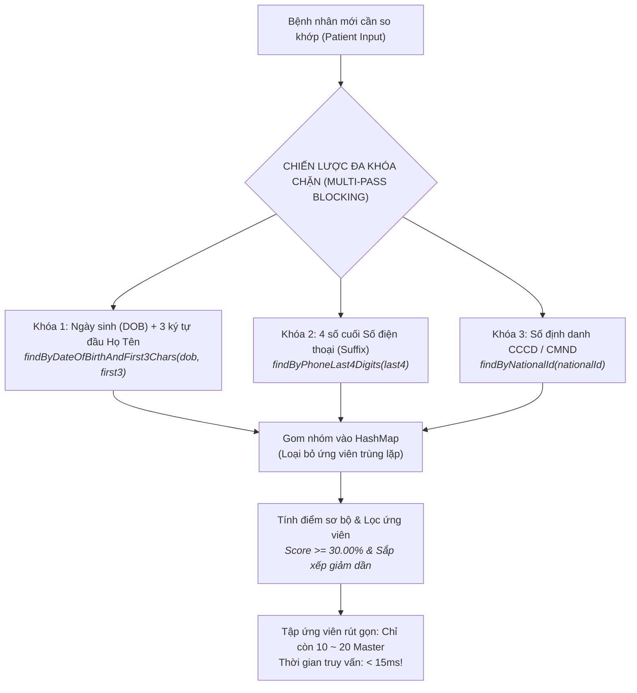
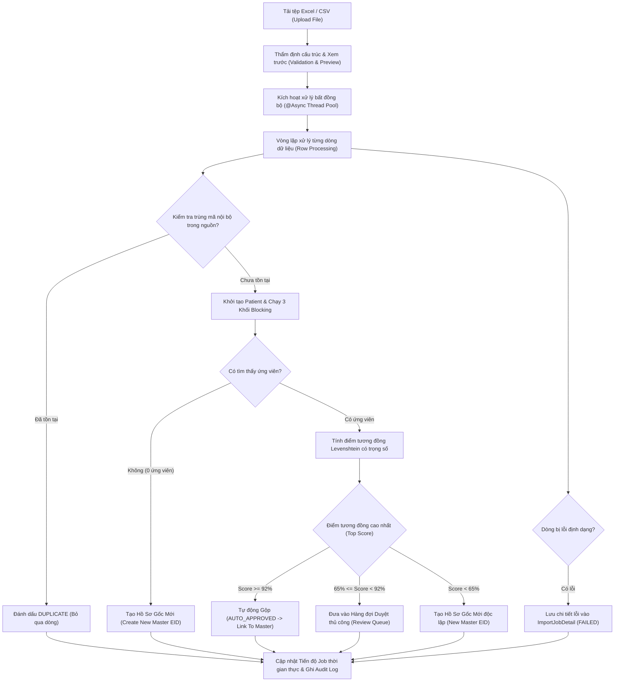

# BÁO CÁO THIẾT KẾ SLIDE THUYẾT TRÌNH ĐỀ TÀI (GIAO DIỆN SÁNG - LIGHT THEME)
## ĐỀ TÀI: HỆ THỐNG QUẢN LÝ ĐỊNH DANH BỆNH NHÂN TẬP TRUNG (MASTER PATIENT INDEX - MPI)

---

## 🎨 QUY CHUẨN THIẾT KẾ GIAO DIỆN SÁNG (LIGHT THEME DESIGN SPECIFICATION)
* **Phong cách chủ đạo:** Modern Medical & Enterprise SaaS — Tối giản, thanh lịch, trang nhã và chuẩn y tế kỹ thuật số.
* **Bảng màu giao diện sáng (Light Color Palette):**
  * **Màu nền trang chiếu (Slide Background):** Trắng tuyết sáng `#FFFFFF` kết hợp gradient tinh tế xám bạc `#F8FAFC` và viền lưới mờ (Subtle Grid Pattern `#E2E8F0`).
  * **Màu chữ chính (Primary Text):** Xanh đen thẫm `#0F172A` (Slate-900) tạo độ tương phản cao, chống lóa mắt.
  * **Màu chữ phụ (Secondary Text):** Xám tro `#475569` (Slate-600) cho mô tả và ghi chú.
  * **Màu chủ đạo ngành y tế (Medical Primary):** Xanh biển y tế `#0284C7` (Sky-600) và `#0369A1` (Sky-700).
  * **Màu trạng thái thành công / Tự động duyệt:** Xanh lục bảo `#059669` (Emerald-600) trên nền pastel `#ECFDF5`.
  * **Màu trạng thái cảnh báo / Cần duyệt tay:** Cam hổ phách `#D97706` (Amber-600) trên nền pastel `#FFFBEB`.
  * **Màu trạng thái rủi ro / Lỗi / Từ chối:** Đỏ hồng `#DC2626` (Rose-600) trên nền pastel `#FEF2F2`.
  * **Màu công nghệ / Nổi bật:** Tím thạch anh `#7C3AED` (Violet-600) trên nền pastel `#F5F3FF`.
* **Hiệu ứng đồ họa thẻ (Card & Bento Grid):** Thẻ nổi trên nền trắng, bo góc lớn `16px - 20px`, viền mảnh mờ `1px solid #E2E8F0`, đổ bóng êm ái (Soft Box Shadow `0 10px 25px -5px rgba(0,0,0,0.05)`).
* **Kiểu chữ (Typography):** Font chữ không chân cao cấp `Plus Jakarta Sans` / `Inter`, font mã nguồn `JetBrains Mono`.

---

## 📋 MỤC LỤC TỔNG THỂ 10 SLIDE

* **Slide 1:** Trang tiêu đề — Giới thiệu Đề tài Hệ thống Quản lý Định danh Bệnh nhân Tập trung (MPI).
* **Slide 2:** Bối cảnh & Thực trạng phân mảnh dữ liệu y tế — Thách thức và hậu quả lâm sàng.
* **Slide 3:** Giải pháp đề tài — Hệ thống MPI & Mô hình Hồ Sơ Gốc (Golden Record / Enterprise ID).
* **Slide 4:** Thuật toán Cốt lõi (P1) — Chiến lược Tìm kiếm Ứng viên Master (Multi-pass Blocking Strategy).
* **Slide 5:** Thuật toán Cốt lõi (P2) — Thuật toán Tính điểm Xác suất (Levenshtein Distance & Weighted Probabilistic Matching).
* **Slide 6:** Quy trình Quyết định & Hàng đợi Thẩm định (Review Queue) & Cơ chế Unlink sửa sai thông minh.
* **Slide 7:** Ngăn xếp Công nghệ Hiện đại (Full-Stack Technology Stack).
* **Slide 8:** Tổng hợp Tính năng Đã Làm (P1) — Phân hệ Nghiệp vụ Bệnh nhân & Nạp Dữ Liệu Lớn.
* **Slide 9:** Tổng hợp Tính năng Đã Làm (P2) — Phân hệ Quản trị, Mạng lưới Y tế & Nhật ký Truy vết.
* **Slide 10:** Giá trị Thực tiễn Đạt Được & Lộ trình Phát triển Tương lai (Roadmap).

---

## 📑 CHI TIẾT NỘI DUNG TỪNG SLIDE & LỜI THOẠI THUYẾT TRÌNH (SPEAKER NOTES)

---

### SLIDE 1: TRANG TIÊU ĐỀ (TITLE SLIDE)

#### 1. Định hướng Thiết kế Giao diện Sáng:
* Nền trắng tinh khôi `#FFFFFF` phối dải sóng gradient xanh y tế nhạt (`rgba(2, 132, 199, 0.05)`).
* Badge nổi bật ở đỉnh slide: `HỆ THỐNG Y TẾ SỐ • ENTERPRISE MASTER PATIENT INDEX`.
* Tiêu đề lớn in đậm màu xanh thẫm `#0369A1` và `#0F172A`.
* 4 Card thông số tóm tắt viền xanh nhạt, nền trắng kem sang trọng.

#### 2. Nội dung hiển thị trên Slide:
* **Tiêu đề chính:** HỆ THỐNG QUẢN LÝ ĐỊNH DANH BỆNH NHÂN TẬP TRUNG (MASTER PATIENT INDEX - MPI)
* **Phụ đề:** Chuẩn hóa, Khử trùng lặp và Hợp nhất Hồ sơ Bệnh nhân Toàn diện Liên cơ sở Y tế — Xây dựng Nguồn Chân Lý Dữ Liệu Duy Nhất (Golden Record)
* **Thông tin báo cáo:**
  * **Họ tên người thực hiện:** Nhật Hoàng Long
  * **Công nghệ nòng cốt:** Java 21 LTS • Spring Boot 3.x • Angular 19 • MySQL 8 • Spring Security
  * **Lĩnh vực ứng dụng:** Bệnh Án Điện Tử (EMR) & Hồ Sơ Sức Khỏe Toàn Dân (EHR)
  * **Trạng thái triển khai:** Production Ready (Phiên bản v2.5 hoàn chỉnh)
* **Các điểm nhấn công nghệ:**
  * `Thuật toán Blocking đa khóa` | `Khoảng cách Levenshtein NFD` | `Review Queue Đối soát Trực quan` | `Bảo mật JWT + HttpOnly Cookie`

> 🎙️ **Lời thoại thuyết trình (Speaker Notes):**  
> *"Kính thưa quý Thầy Cô trong Hội đồng và các bạn, trong tiến trình chuyển đổi số y tế quốc gia và triển khai Bệnh án điện tử (EMR), bài toán lớn nhất hiện nay là tình trạng dữ liệu bệnh nhân bị phân tán, trùng lặp và không thể liên kết giữa các cơ sở khám chữa bệnh. Hôm nay, em xin trân trọng trình bày đề tài 'Hệ thống Quản lý Định danh Bệnh nhân Tập trung (Master Patient Index - MPI)', một giải pháp công nghệ toàn diện giúp định danh chính xác, tự động hợp nhất hồ sơ bệnh nhân và bảo đảm an toàn điều trị lâm sàng."*

---

### SLIDE 2: BỐI CẢNH & THỰC TRẠNG VẤN ĐỀ ĐANG GẶP PHẢI (PROBLEM STATEMENT)

#### 1. Định hướng Thiết kế Giao diện Sáng:
* Header mang badge đỏ cam: `01. Bối cảnh & Thực trạng`.
* Bố cục 3 Card lớn dạng cột trắng viền xám sáng `#E2E8F0`, icon đỏ hồng `#DC2626` cảnh báo rủi ro.
* Khối Callout dưới cùng nền đỏ hồng pastel `#FEF2F2`, viền đỏ `#F87171` làm nổi bật 2 hậu quả nghiêm trọng nhất.

#### 2. Nội dung hiển thị trên Slide:
* **Thực trạng 1: Phân mảnh dữ liệu y tế (Data Silos giữa các viện)**
  * Mỗi bệnh viện, phòng khám, trung tâm y tế sử dụng một phần mềm quản lý (HIS, LIS, RIS/PACS) độc lập.
  * Cùng một con người nhưng mỗi nơi cấp một mã bệnh nhân cục bộ (`Local Patient ID`) khác nhau.
  * Dữ liệu khám bệnh bị "cô lập", bác sĩ viện này không xem được tiền sử điều trị của viện khác.
* **Thực trạng 2: Dữ liệu đầu vào sai lệch & chất lượng thấp**
  * Nhập liệu tiếp đón thủ công dẫn đến sai chính tả tiếng Việt có dấu/không dấu (VD: `Nguyễn Văn An` vs `Nguyen Van An` hoặc lỗi gõ Telex `Nguyeenx`).
  * Thiếu thông tin định danh: Người bệnh không mang CCCD/BHYT, chỉ nhớ năm sinh mà không nhớ ngày tháng.
  * Người bệnh đổi số điện thoại, chuyển nơi ở khiến hệ thống ghi nhận thành người mới.
* **Thực trạng 3: Trùng lặp hồ sơ trầm trọng (Duplicate Records)**
  * Trung bình một người bệnh có từ 3 đến 5 hồ sơ y tế độc lập tồn tại song song.
  * Xuất hiện hàng nghìn "hồ sơ ma" làm sai lệch hoàn toàn báo cáo thống kê dịch tễ học và quản trị viện.

* **Hộp cảnh báo: HẬU QUẢ NGHIÊM TRỌNG ĐỐI VỚI BỆNH NHÂN & BỆNH VIỆN**
  * ⚠️ **Rủi ro y khoa trực tiếp (Clinical Hazard):** Bác sĩ tuyến trên không biết bệnh nhân có tiền sử dị ứng kháng sinh penicillin hoặc mang bệnh nền tim mạch ở viện trước $\rightarrow$ Nguy cơ chỉ định sai phác đồ, sốc phản vệ, đe dọa trực tiếp tính mạng người bệnh.
  * ⚠️ **Lãng phí tài chính & Thất thoát BHYT:** Bệnh nhân phải chụp lại X-Quang, chụp CT, MRI, làm xét nghiệm máu nhiều lần dù vừa thực hiện ở cơ sở tuyến dưới trước đó vài ngày $\rightarrow$ Gây tốn kém chi phí xã hội và quá tải quỹ bảo hiểm y tế.

> 🎙️ **Lời thoại thuyết trình (Speaker Notes):**  
> *"Thưa Thầy Cô, khi một bệnh nhân đến khám tại viện Bạch Mai, họ có mã BN_01; tuần sau đến viện Chợ Rẫy, họ lại được cấp mã BN_99. Hai hệ thống không hề biết đây là cùng một con người. Nguy hiểm hơn, nếu người bệnh bị dị ứng thuốc hoặc có tiền sử suy thận ở viện trước, bác sĩ viện sau không có thông tin sẽ kê đơn thuốc gây sốc phản vệ. Đồng thời, việc làm lại hàng loạt xét nghiệm tốn kém gây lãng phí lớn. Đây chính là động lực cấp thiết để xây dựng hệ thống MPI."*

---

### SLIDE 3: GIẢI PHÁP ĐỀ TÀI & GIỚI THIỆU HỆ THỐNG MPI LÀ GÌ

#### 1. Định hướng Thiết kế Giao diện Sáng:
* Header mang badge xanh dương: `02. Giải pháp đề tài`.
* Chia làm 2 khối thẻ đối xứng: Khái niệm & Kiến trúc Golden Record (bên trái) và Quy trình xử lý Hybrid 3 luồng (bên phải).
* Dùng hình minh họa liên kết thẻ: Các `Local ID` từ nhiều viện đều trỏ mũi tên vào một `Enterprise ID (EID)`.

#### 2. Nội dung hiển thị trên Slide:
* **Định nghĩa Master Patient Index (MPI):**
  * Là hệ thống cơ sở dữ liệu định danh bệnh nhân trung tâm, đóng vai trò **"Nguồn chân lý duy nhất" (Single Source of Truth)** kết nối toàn bộ mạng lưới y tế.
  * Nhiệm vụ: Tự động thu nhận, chuẩn hóa, so khớp và quản trị vòng đời định danh của mọi bệnh nhân.
* **Khái niệm "Hồ Sơ Gốc" (Golden Record - Enterprise Master Patient - `patient_master`):**
  * Hệ thống sinh duy nhất một mã định danh doanh nghiệp **Enterprise ID (EID)** (VD: `EID-2026-000452`) đại diện cho công dân đó suốt đời.
  * Các bản ghi bệnh nhân nguồn (`patient`) từ các hệ thống HIS, LIS, file Excel nhập vào sẽ được liên kết (`master_patient_id`) trỏ về mã EID này.
* **Mô hình Xử lý So khớp Hybrid (Tự động + Thẩm định thủ công):**
  * **1. Tự động gộp (Auto-Match & Merge - Ngưỡng cao $\ge 92\%$):**
    * Khi độ tin cậy trùng khớp gần như tuyệt đối (trùng số CCCD hoặc chuẩn Họ tên + Ngày sinh + Số điện thoại) $\rightarrow$ Hệ thống tự động gán vào Golden Record hiện có mà không cần can thiệp tay.
  * **2. Hàng đợi thẩm định (Review Queue - Ngưỡng nghi ngờ $65\% \le \text{Score} < 92\%$):**
    * Dành cho các hồ sơ nghi vấn $\rightarrow$ Hệ thống đẩy vào hàng đợi chờ chuyên viên y tế (Reviewer) xem xét qua giao diện So sánh Trực quan (Diff Viewer) trước khi bấm duyệt.
  * **3. Tạo mới hoàn toàn (New Master EID - Ngưỡng thấp $< 65\%$):**
    * Bệnh nhân hoàn toàn mới lần đầu xuất hiện $\rightarrow$ Tự động sinh mã Enterprise ID mới và tạo bản ghi Golden Record mới.

> 🎙️ **Lời thoại thuyết trình (Speaker Notes):**  
> *"Giải pháp đề tài là xây dựng hệ thống MPI đóng vai trò hạt nhân trung tâm. Mỗi người dân chỉ có duy nhất một 'Hồ Sơ Gốc' mang mã Enterprise ID (EID). Dù bệnh nhân đi khám ở 10 bệnh viện khác nhau với 10 mã hồ sơ nguồn khác nhau, hệ thống MPI sẽ liên kết tất cả về cùng một mã EID. Hệ thống hoạt động theo cơ chế Hybrid: Tự động gộp ngay với hồ sơ tin cậy cao trên 92%, đưa vào hàng đợi cho nhân viên y tế duyệt đối với hồ sơ nghi ngờ từ 65% đến 92%, và tự động cấp mã mới nếu điểm dưới 65%."*

---

### SLIDE 4: THUẬT TOÁN TÌM KIẾM ỨNG VIÊN MASTER (BLOCKING STRATEGY)
*(Được thiết kế bám sát 100% logic mã nguồn trong `PatientMatchingServiceImpl.java` & `PatientMasterRepository.java`)*

#### 1. Định hướng Thiết kế Giao diện Sáng:
* Header badge: `03. Thuật toán Cốt lõi (P1)`.
* Trực quan hóa phép so sánh: Bảng so sánh giữa So sánh vét cạn ($O(N \times M)$) và Chiến lược Blocking ($O(1)$).
* 3 Khối thẻ Blocking nổi bật với badge xanh cyan `#0284C7`, xanh lá `#059669`, tím `#7C3AED` hiển thị chi tiết câu lệnh truy vấn JPA/SQL thực tế.

#### 2. Nội dung hiển thị trên Slide:

* **Thách thức bài toán dữ liệu lớn (Big Data Challenge):**
  * Nếu nạp vào $N$ bệnh nhân mới và so sánh chuỗi Levenshtein vét cạn với $M$ hồ sơ trong CSDL:
  * **Độ phức tạp tính toán:** $\mathcal{O}(N \times M)$
  * Giả sử: $N = 10.000$ bệnh nhân nạp mới $\times$ $M = 1.000.000$ hồ sơ gốc $\rightarrow$ Hệ thống phải thực hiện **10 TỶ phép tính Levenshtein**!
  * **Hậu quả:** Gây cạn kiệt CPU, tràn bộ nhớ Heap RAM, đơ cơ sở dữ liệu và treo toàn bộ API!

* **Giải pháp: Chiến lược Đa Khóa Chặn (Multi-pass Blocking Strategy):**
  * Hệ thống chia không gian tìm kiếm thành các "khối" (Blocks) dựa trên các chỉ mục (Composite Index) có sẵn trên Database.
  * Trong hàm `findMatchCandidates(Patient patient)`, hệ thống thực hiện 3 khóa chặn song song:



* **Chi tiết 3 Khóa Chặn theo Code Java:**
  * **Khóa 1 (Ngày sinh + 3 chữ cái đầu của Tên):**
    * Code: `String first3 = patient.getFullName().substring(0, 3).toUpperCase();`
    * SQL: `WHERE pm.date_of_birth = ?1 AND UPPER(SUBSTRING(pm.full_name, 1, 3)) = ?2 AND pm.status = 'ACTIVE'`
    * Ý nghĩa: Gom nhóm những người cùng ngày tháng năm sinh và có cùng tiền tố họ (VD: "NGU" cho Nguyễn, "TRA" cho Trần).
  * **Khóa 2 (4 số cuối của Số điện thoại):**
    * Code: `String last4 = patient.getPhoneNumber().substring(len - 4);`
    * SQL: `WHERE pm.phone_number LIKE %?1 AND pm.status = 'ACTIVE'`
    * Ý nghĩa: Bắt trường hợp người bệnh đổi nhà mạng, đổi đầu số (098 $\rightarrow$ 038) hoặc gõ nhầm mã vùng nhưng đuôi 4 số vẫn giữ nguyên.
  * **Khóa 3 (Số định danh CCCD/CMND):**
    * Code: `patientMasterRepository.findByNationalId(patient.getNationalId());`
    * SQL: `WHERE pm.national_id = ?1 AND pm.status = 'ACTIVE'`
    * Ý nghĩa: Bắt trúng ngay lập tức các hồ sơ mang CCCD 12 số chuẩn quốc gia qua Index B-Tree.

* **Kết quả vượt trội:** Giảm từ **1.000.000** bản ghi xuống chỉ còn **10 ~ 20** ứng viên tiềm năng, thời gian thực thi chỉ mất **dưới 15ms**!

> 🎙️ **Lời thoại thuyết trình (Speaker Notes):**  
> *"Thưa Thầy Cô, điểm mấu chốt về hiệu năng của hệ thống nằm ở thuật toán Blocking này. Nếu so sánh 10.000 bệnh nhân mới với 1 triệu hồ sơ cũ, việc so sánh từng đôi một sẽ tốn 10 tỷ phép tính và làm sập server. Em đã áp dụng kỹ thuật Multi-pass Blocking với 3 chìa khóa: Khóa 1 là Ngày sinh + 3 chữ cái đầu Họ Tên; Khóa 2 là 4 số cuối điện thoại; Khóa 3 là số CCCD. Ba khóa này chạy truy vấn Index siêu tốc, gom vào một HashMap để khử trùng lặp và chỉ lọc ra những ai có điểm sơ bộ trên 30%. Nhờ đó, thay vì quét cả triệu hồ sơ, máy chủ chỉ cần tính điểm chi tiết cho 10 đến 20 ứng viên trong chưa đầy 15 mili-giây."*

---

### SLIDE 5: THUẬT TOÁN TÍNH ĐIỂM XÁC SUẤT (PROBABILISTIC MATCHING ENGINE)
*(Phân tích chi tiết code chuẩn hóa tiếng Việt, Levenshtein Distance & Công thức Trọng số)*

#### 1. Định hướng Thiết kế Giao diện Sáng:
* Header badge: `04. Thuật toán Cốt lõi (P2)`.
* Bố cục 2 cột: Cột trái trình bày cơ chế Chuẩn hóa & Khoảng cách Levenshtein; Cột phải trình bày Bảng trọng số cấu hình động (`AlgorithmWeightConfig`).
* Khối minh họa phép tính: Đóng khung viền xanh dương, font `JetBrains Mono` dễ đọc.

#### 2. Nội dung hiển thị trên Slide:

* **1. Tiền xử lý & Chuẩn hóa chuỗi tiếng Việt (Normalization):**
  * Trước khi so sánh, chuỗi được chuẩn hóa qua hàm `normalize(String s)` trong mã nguồn:
  * Sử dụng chuẩn **NFD (Canonical Decomposition)** để bóc tách các dấu thanh tiếng Việt (sắc, huyền, hỏi, ngã, nặng) thành ký tự tổ hợp, sau đó dùng Regular Expression `\p{M}` để loại bỏ hoàn toàn dấu, đưa về chữ thường và xóa khoảng trắng thừa:
  ```java
  private String normalize(String s) {
      return Normalizer.normalize(s.trim().toLowerCase(), Normalizer.Form.NFD)
              .replaceAll("\\p{M}", "");
  }
  ```
  * *Ví dụ:* `"Nguyễn Văn An"` $\rightarrow$ chuyển thành `"nguyen van an"`. Giúp giải quyết triệt để lỗi gõ dấu máy tính (Telex/VNI) hoặc dữ liệu không dấu từ các phần mềm cũ.

* **2. Thuật toán Khoảng cách Levenshtein (Levenshtein Distance):**
  * Đo lường số phép biến đổi ký tự tối thiểu (chèn, xóa, thay thế) để biến chuỗi $s_1$ thành chuỗi $s_2$.
  * Hệ thống tối ưu hóa bộ nhớ chỉ sử dụng mảng 1 chiều `costs[b.length() + 1]` thay vì ma trận $2D$ tốn RAM:
  * Công thức quy đổi độ tương đồng chuẩn hóa về khoảng $[0.0, 1.0]$:
  $$\text{Similarity}(s_1, s_2) = 1.0 - \frac{\text{LevenshteinDistance}(n_1, n_2)}{\max(\text{len}(n_1), \text{len}(n_2))}$$
  * *Ví dụ:* `"Nguyễn Văn An"` vs `"Nguyen Van An"` $\rightarrow$ Sau chuẩn hóa khoảng cách bằng $0$ $\rightarrow$ Độ tương đồng = **100% (1.0)**!

* **3. Bảng Phân Bổ Trọng Số Cấu Hình Động (`AlgorithmWeightConfig`):**
  * Tổng điểm tương đồng được tính theo phương pháp trọng số xác suất:
  $$\text{MatchScore} = \sum_{i} \Big( \text{Weight}_i \times \text{Similarity}_i \Big)$$

| Thuộc tính so khớp | Trọng số mặc định | Cơ chế đánh giá trong Code | Mô tả kỹ thuật |
| :--- | :---: | :--- | :--- |
| **Số CCCD / CMND** | **40%** | `isExactMatch` | Khớp tuyệt đối không phân biệt hoa thường |
| **Họ và tên** | **25%** | `calculateStringSimilarity` | Chuẩn hóa NFD + Thuật toán Levenshtein |
| **Ngày sinh (DOB)** | **15%** | `LocalDate.equals` | Khớp chính xác ngày, tháng, năm sinh |
| **Số điện thoại** | **15%** | `isExactMatch` | Khớp chính xác chuỗi số điện thoại liên lạc |
| **Địa chỉ thường trú** | **5%** | `calculateStringSimilarity` | So sánh độ tương đồng chuỗi địa chỉ xã/huyện |
| **TỔNG ĐIỂM TỐI ĐA** | **100.00%** | `score.setScale(2, HALF_UP)` | Làm tròn 2 chữ số thập phân |

> 🎙️ **Lời thoại thuyết trình (Speaker Notes):**  
> *"Thưa Thầy Cô, ở phần tính điểm, hệ thống xử lý rất kỹ đặc thù tiếng Việt. Trước khi so sánh, hàm normalize sẽ chuyển chuỗi sang dạng NFD để bóc tách dấu, giúp chuỗi 'Nguyễn Văn An' và 'Nguyen Van An' trở nên tương đồng 100%. Tiếp theo, thuật toán Levenshtein được áp dụng để tính khoảng cách sai khác giữa 2 chuỗi tên và địa chỉ. Cuối cùng, điểm số được tổng hợp theo ma trận trọng số: CCCD chiếm 40% vì là định danh pháp lý cao nhất; Họ tên chiếm 25%; Ngày sinh 15%; Số điện thoại 15% và Địa chỉ 5%. Tất cả trọng số này đều có thể tùy biến linh hoạt mà không cần phải can thiệp sửa code."*

---

### SLIDE 6: QUY TRÌNH QUYẾT ĐỊNH & HÀNG ĐỢI THẨM ĐỊNH (REVIEW QUEUE) & CƠ CHẾ UNLINK
*(Chi tiết logic duyệt, so sánh trực quan Diff Viewer và xử lý Unlink khi gộp nhầm)*

#### 1. Định hướng Thiết kế Giao diện Sáng:
* Header badge: `05. Quy trình Nghiệp vụ`.
* Sơ đồ dòng quyết định (Decision Flowchart) với 3 màu pastel sáng: Xanh lá (Auto Approved), Vàng cam (Review Queue), Đỏ hồng (New Master).
* Trực quan hóa màn hình Diff Viewer và cơ chế Unmerge / Unlink tự động.

#### 2. Nội dung hiển thị trên Slide:

* **1. Phân tầng ngưỡng quyết định tự động (`getAutoDecision`):**
  * **Mức 1: $\text{MatchScore} \ge 92\%$ (`AUTO_APPROVED`):**
    * Tự động liên kết `patient.master_patient = targetMaster`, trạng thái `MATCHED`.
    * Tự động từ chối các ứng viên nghi ngờ khác còn lại của cùng bệnh nhân đó.
  * **Mức 2: $65\% \le \text{MatchScore} < 92\%$ (`PENDING`):**
    * Lưu vào bảng `match_candidate`. Đưa vào danh sách **Hàng đợi duyệt (Review Queue)**.
    * Tạo cấu trúc JSON `score_breakdown` lưu chi tiết điểm thành phần từng trường để phục vụ hiển thị.
  * **Mức 3: $\text{MatchScore} < 65\%$ (`REJECTED`):**
    * Không liên kết, kích hoạt `patientMasterService.createMaster(patient)` để sinh mã Enterprise ID mới.

* **2. Màn hình So sánh Đối soát Trực quan (Diff Viewer):**
  * Giao diện chia 2 cột đối sánh song song: Hồ sơ Bệnh nhân nguồn vs Hồ sơ Gốc (Master Record).
  * Tự động làm nổi bật (Highlight) bằng màu sắc: Các trường trùng khớp hoàn toàn bôi xanh lá; các trường khác biệt bôi cam cảnh báo.
  * Thẻ điểm chi tiết (Score Breakdown): Thể hiện trực quan CCCD đạt 40/40, Tên đạt 23.5/25, SĐT đạt 15/15... giúp chuyên viên ra quyết định chỉ trong 3 giây.
  * Nút bấm thao tác dứt khoát: **Duyệt gộp (Manual Approve)** hoặc **Từ chối (Reject)** kèm ghi chú thẩm định.

* **3. Cơ chế Unlink & Sửa sai thông minh (Smart Unmerge Logic):**
  * *Tình huống thực tế:* Chuyên viên lỡ tay bấm từ chối hồ sơ A (hệ thống sinh tạm một Master mới), sau đó phát hiện hồ sơ B mới là đúng và bấm duyệt gộp lại.
  * *Hệ thống tự động xử lý:*
    1. Kiểm tra nếu Master cũ tạo nhầm chỉ có 1 bệnh nhân $\rightarrow$ Tự động xóa Master tạo nhầm (dọn rác Database sạch sẽ).
    2. Nếu Master cũ là một Master hợp lệ $\rightarrow$ Gỡ liên kết (Unlink), chuyển candidate cũ sang `REJECTED`.
    3. Ghi nhật ký vào bảng `match_decision_log` với hành động `UNMERGE`: *"Hồ sơ bệnh nhân X đã được tách (unlink) khỏi mã EID: Y để chuyển sang gộp vào mã EID: Z"*.
    4. Ghi nhận chính xác danh tính người thực hiện thao tác qua User đăng nhập hiện tại (không gán cứng tên).

> 🎙️ **Lời thoại thuyết trình (Speaker Notes):**  
> *"Một tính năng rất thông minh trong đề tài là Hàng đợi thẩm định Review Queue kết hợp cơ chế Unlink. Khi điểm số rơi vào vùng nghi ngờ từ 65% đến 92%, hệ thống không tự ý quyết định mà đưa ra màn hình so sánh Diff Viewer 2 cột với màu sắc trực quan để chuyên viên y tế thẩm định. Nếu chuyên viên duyệt gộp, hệ thống sẽ tự động gán vào Master. Đặc biệt, nếu trước đó chuyên viên có lỡ từ chối nhầm khiến hệ thống sinh ra một Master tạm, thì khi duyệt gộp lại, hệ thống sẽ tự động Unlink tách bệnh nhân ra, xóa bỏ Master tạo nhầm và ghi log truy vết rõ ràng ai đã Unlink lúc mấy giờ."*

---

### SLIDE 7: QUY TRÌNH NGHIỆP VỤ TOÀN TRÌNH: TỪ NẠP TỆP (IMPORT FILE) ĐẾN HỢP NHẤT HỒ SƠ GỐC

#### 1. Định hướng Thiết kế Giao diện Sáng:
* Header badge: `06. Luồng Nghiệp Vụ Toàn Trình (End-to-End)`.
* Bố cục 4 Card quy trình nối tiếp theo trục thời gian (Horizontal Timeline / Step Pipeline) trên nền trắng tinh khiết, viền xanh dương y tế (`#0284C7`), điểm xuyết các Badge trạng thái xanh lá (`#16A34A`), hổ phách (`#D97706`), đỏ (`#DC2626`).
* Tích hợp sơ đồ Mermaid trực quan hóa trọn vẹn luồng dữ liệu từ lúc tải file Excel/CSV đến khi chốt quyết định Master Record.



#### 2. Nội dung hiển thị trên Slide:

* **Bước 1: Tiếp nhận Tệp & Thẩm định Cấu trúc (File Upload & Validation)**
  * Người dùng chọn Hệ thống nguồn (`SourceSystem`), chọn tệp dữ liệu Excel (`.xlsx`) hoặc `.csv` chứa hàng nghìn hồ sơ bệnh nhân.
  * API `POST /api/v1/imports/upload`: Lưu tệp an toàn vào hệ thống tệp cục bộ (`FileStorageService`), cấp phát mã token tệp duy nhất, kiểm tra định dạng và đếm số dòng dữ liệu.
  * API `GET /api/v1/imports/{jobId}/preview`: Trả về dữ liệu mẫu để người dùng kiểm tra ánh xạ cột (Column Mapping: Mã nội bộ, Họ tên, CCCD, BHYT, SĐT, Địa chỉ, Giới tính, Ngày sinh).

* **Bước 2: Điều phối & Kích hoạt Bất Đồng Bộ (Async Job Orchestration)**
  * Người dùng nhấn nút **"Bắt đầu nạp"** $\rightarrow$ API `POST /api/v1/imports/start`.
  * Bộ điều phối `ImportJobOrchestrator` lưu thông tin Job vào CSDL với trạng thái `PENDING`, sau đó chuyển giao ngay cho `AsyncImportProcessor` chạy trên luồng riêng `@Async("importTaskExecutor")`.
  * API phản hồi HTTP về cho Frontend trong vài mili-giây, ngăn chặn hoàn toàn hiện tượng nghẽn luồng HTTP request (Timeout) khi tải tệp hàng chục ngàn dòng.
  * Phía Frontend tự động thiết lập chu kỳ Polling `GET /api/v1/imports/{jobId}` để hiển thị thanh tiến độ (% hoàn thành, số dòng thành công, trùng lặp, cảnh báo nghi ngờ, lỗi).

* **Bước 3: Động Cơ So Khớp Từng Dòng Dữ Liệu (Row-level Processing Pipeline)**
  * Worker nền đọc từng dòng dữ liệu trong tệp, thực hiện xử lý an toàn độc lập:
    * **Kiểm tra trùng mã nội bộ:** `patientRepository.existsBySourceSystemIdAndLocalPatientCode()`. Nếu cùng nguồn đã nạp mã này rồi $\rightarrow$ Đánh dấu `DUPLICATE`, tăng biến đếm `duplicateRows`.
    * **Khởi tạo thực thể Patient:** Chuẩn hóa dữ liệu dòng và lưu vào bảng `patient` với trạng thái ban đầu `PENDING`.
    * **Quét tìm ứng viên qua 3 khối Blocking độc lập:** Chạy tuần tự Khối 1 (Ngày sinh + 3 chữ đầu tên), Khối 2 (4 số cuối SĐT), Khối 3 (CCCD).
    * **Phân luồng quyết định:**
      * *Không có ứng viên:* Bệnh nhân mới hoàn toàn $\rightarrow$ Tự động sinh `PatientMaster` mới với mã `MPI-xxxxxxxx`. Đánh dấu dòng `SUCCESS`.
      * *Tìm thấy ứng viên:* Chấm điểm tương đồng Levenshtein có trọng số.
        - **$\ge 92\%$ (`AUTO_APPROVED`):** Tự động gộp vào Hồ sơ gốc (`linkToMaster`), ghi vết quyết định, đánh dấu dòng `SUCCESS`.
        - **$65\% \le \text{Score} < 92\%$ (`PENDING`):** Nghi vấn trùng lặp $\rightarrow$ Đẩy vào Hàng đợi rà soát thủ công (`Review Queue`), đánh dấu dòng `REQUIRES_REVIEW` (cảnh báo vàng).
        - **$< 65\%$ (`REJECTED`):** Không đủ độ tin cậy để gộp $\rightarrow$ Tự động tạo Hồ sơ gốc mới độc lập. Đánh dấu dòng `SUCCESS`.
    * **Cơ chế cô lập lỗi (Fault Isolation):** Nếu dòng dữ liệu nào sai định dạng ngày sinh hoặc thiếu trường bắt buộc $\rightarrow$ Đánh dấu `FAILED`, ghi rõ nguyên nhân lỗi vào `ImportJobDetail`. Các dòng khác trong file vẫn được xử lý bình thường mà không bị dừng đột ngột.

* **Bước 4: Hoàn Tất, Báo Cáo & Xử Lý Sau Nạp (Completion & Post-Actions)**
  * Chốt trạng thái Job là `COMPLETED`, lưu thời gian kết thúc `completedAt`.
  * Bảng tổng kết trực quan hiển thị số lượng: *Thành công, Trùng lặp, Cảnh báo nghi ngờ, Thất bại*.
  * Cung cấp nút bấm **"Thử lại các dòng lỗi (Retry Failed Rows)"** qua API `POST /api/v1/imports/{jobId}/retry-failed` giúp nạp lại mà không cần tải lại cả tệp.
  * Chuyển hướng nhanh đến **Hàng đợi xét duyệt (Review Queue)** để chuyên viên y tế thẩm định các hồ sơ ở trạng thái cảnh báo nghi ngờ.

> 🎙️ **Lời thoại thuyết trình (Speaker Notes):**  
> *"Kính thưa Thầy Cô, đây là Slide thể hiện toàn diện luồng nghiệp vụ thực tế của hệ thống từ lúc nạp tệp cho đến khi hoàn tất hồ sơ gốc. Đầu tiên, người dùng tải file Excel hoặc CSV lên, hệ thống thẩm định cấu trúc và cho xem trước dữ liệu mẫu. Khi bấm bắt đầu, hệ thống áp dụng cơ chế xử lý bất đồng bộ qua Spring @Async, giải phóng ngay luồng HTTP giúp người dùng không phải chờ đợi và có thể theo dõi thanh tiến độ thời gian thực.  
> Trong luồng nền, từng dòng dữ liệu được kiểm tra trùng mã nội bộ, sau đó đi qua động cơ ghép nối 3 khối Blocking và chấm điểm Levenshtein. Nếu điểm từ 92% trở lên, hệ thống tự động gộp vào Master Record. Nếu từ 65% đến dưới 92%, hệ thống đưa vào Review Queue để bác sĩ thẩm định. Nếu dưới 65% hoặc không có ứng viên, hệ thống tự động cấp phát một mã Master EID mới. Đặc biệt, hệ thống có cơ chế cô lập lỗi cực kỳ chặt chẽ: dòng nào lỗi thì ghi log riêng để bấm Retry sau, hoàn toàn không làm gián đoạn các dòng hợp lệ khác."*

---

### SLIDE 8: NGĂN XẾP CÔNG NGHỆ HIỆN ĐẠI (FULL-STACK TECH STACK)

#### 1. Định hướng Thiết kế Giao diện Sáng:
* Header badge: `07. Kiến trúc Kỹ thuật`.
* Bố cục Bento Grid 4 góc hiện đại, nền thẻ trắng sáng, bo góc `18px`, icon công nghệ sắc nét.
* Mỗi nhóm công nghệ có các Pill Tag màu sắc trang nhã, phân biệt rõ vai trò trong hệ thống.

#### 2. Nội dung hiển thị trên Slide:

* **1. Backend Framework & Core Architecture:**
  * **Java 21 / 25 LTS:** Sử dụng cú pháp mới, hiệu năng xử lý luồng cao, Record DTO bất biến.
  * **Spring Boot 3.x:** Nền tảng micro-framework mạnh mẽ, tích hợp Spring MVC, Dependency Injection.
  * **Spring Data JPA & Hibernate 6:** Quản lý tầng truy cập dữ liệu, tối ưu câu lệnh truy vấn qua JPA Specification.
  * **@Async Thread Pool (`importTaskExecutor`):** Xử lý nhập liệu file Excel/CSV dung lượng lớn chạy nền bất đồng bộ.
  * **Swagger / OpenAPI 3:** Tài liệu hóa API tự động, hỗ trợ kiểm thử trực tiếp trên Swagger UI.

* **2. Frontend Architecture & Modern UI:**
  * **Angular 19 (SPA):** Kiến trúc Component hướng module hóa cao cấp.
  * **Standalone Components:** Loại bỏ hoàn toàn NgModule cồng kềnh, tối ưu thời gian tải trang.
  * **Angular Signals:** Quản lý state phản ứng (Reactive State Management) mượt mà, hạn chế re-render dư thừa.
  * **RxJS Stream:** Xử lý luồng sự kiện tìm kiếm debounce, polling tiến độ import thời gian thực.
  * **Pure CSS Design Tokens:** Hệ thống biến màu, khoảng cách thiết kế nhất quán dạng Bento Grid, không bị lệ thuộc vào thư viện CSS nặng.

* **3. Cơ sở dữ liệu & Xử lý File (Database & Storage):**
  * **MySQL 8.x (InnoDB):** Hỗ trợ toàn vẹn giao dịch ACID, Foreign Key ràng buộc chặt chẽ.
  * **Đánh chỉ mục thông minh (Composite Index):** Đánh Index B-Tree chuyên biệt cho các cột khóa chặn `date_of_birth`, `phone_number`, `national_id`.
  * **Apache POI & OpenCSV:** Thư viện phân tích luồng đọc file Excel (.xlsx) và CSV tốc độ cao.

* **4. An ninh & Bảo mật Doanh nghiệp (Security & DevOps):**
  * **Spring Security 6:** Cấu hình Stateless Session Management hoàn toàn.
  * **Cơ chế Token Kép (Dual JWT):** Access Token thời hạn ngắn (15 phút) + Refresh Token thời hạn dài (7 ngày).
  * **Bảo vệ Cookie `HttpOnly` + `SameSite`:** Chống triệt để các cuộc tấn công đánh cắp phiên XSS (Cross-Site Scripting) và CSRF.
  * **Phân quyền Role-based (RBAC):** Ma trận phân quyền 3 cấp độ: `ADMIN`, `REVIEWER`, `VIEWER`.
  * **Docker Container:** Đóng gói ứng dụng và cơ sở dữ liệu đồng nhất giữa môi trường phát triển và máy chủ vận hành.

> 🎙️ **Lời thoại thuyết trình (Speaker Notes):**  
> *"Về mặt công nghệ, đề tài áp dụng các công nghệ hiện đại nhất hiện nay. Phía Backend là Java 21 kết hợp Spring Boot 3, sử dụng luồng Worker bất đồng bộ để xử lý file lớn mà không gây treo ứng dụng. Phía Frontend là Angular 19 với kỹ thuật Standalone Components và Angular Signals giúp giao diện phản hồi cực nhanh. Cơ sở dữ liệu MySQL 8 được đánh Index chuyên biệt cho các truy vấn Blocking. Đặc biệt, hệ thống bảo mật bằng cơ chế Token kép, lưu Refresh Token trong Cookie HttpOnly để ngăn chặn hoàn toàn nguy cơ tin tặc đánh cắp token qua mã độc XSS."*

---

### SLIDE 9: TỔNG HỢP CÁC TÍNH NĂNG ĐÃ LÀM (P1 - NGHIỆP VỤ BỆNH NHÂN)

#### 1. Định hướng Thiết kế Giao diện Sáng:
* Header badge: `08. Tổng hợp Tính năng (P1)`.
* Bố cục 4 Card lớn dạng lưới $2 \times 2$ đại diện cho 4 module nghiệp vụ bệnh nhân đã hoàn thiện 100%.
* Mỗi tính năng đều có gạch đầu dòng chi tiết và các tag công nghệ liên quan.

#### 2. Nội dung hiển thị trên Slide:

* **Tính năng 1: Quản lý Bệnh nhân Nguồn (Patient Records Management)**
  * Danh sách bệnh nhân tích hợp từ các cơ sở y tế với phân trang chuẩn server-side (`Pageable`).
  * Bộ lọc tìm kiếm đa tiêu chí: Họ tên, Mã bệnh nhân cục bộ, CCCD, Số điện thoại, Cơ sở y tế, Trạng thái đối chiếu (`MATCHED`, `PENDING`, `REJECTED`, `NEW_MASTER`).
  * Bảng thẻ thống kê số lượng toàn hệ thống gọi API thời gian thực: *Tổng số bệnh nhân, Chờ đối chiếu, Đã đối chiếu, Tạo mới* (không bị phụ thuộc vào số lượng của trang hiện tại).
  * Chức năng Thêm mới, Sửa thông tin, Xóa hồ sơ với form validation chặt chẽ (định dạng CCCD 12 số, SĐT 10 số, ngày sinh).

* **Tính năng 2: Nhập Liệu Hàng Loạt Bất Đồng Bộ (Async Batch Import)**
  * Tải lên danh sách bệnh nhân qua file định dạng **Excel (.xlsx)** hoặc **CSV** với dung lượng hàng nghìn dòng.
  * Cơ chế xử lý bất đồng bộ (`@Async`): Hệ thống lưu file, tạo bản ghi `ImportJob`, trả về mã Job ngay lập tức để người dùng không phải chờ đợi.
  * Giao diện giám sát tiến độ thời gian thực: Frontend tự động polling cập nhật tỷ lệ %, số dòng xử lý thành công, số dòng lỗi, số dòng cảnh báo nghi trùng.
  * Khả năng chịu lỗi cao: Dòng nào sai định dạng được lưu chi tiết lỗi vào `ImportJobDetail` để tải về đối soát, các dòng hợp lệ vẫn được đẩy tiếp vào động cơ so khớp.

* **Tính năng 3: Hàng Đợi Phê Duyệt & So Sánh Hồ Sơ (Review Queue & Diff Viewer)**
  * Tự động lọc và hiển thị danh sách các cặp hồ sơ có điểm tương đồng nằm trong vùng nghi ngờ ($65\% \sim 92\%$).
  * Giao diện Diff Viewer chuyên sâu: So sánh 2 cột trực quan giữa Bệnh nhân nguồn và Hồ sơ gốc, highlight màu sắc các trường sai khác.
  * Bảng phân tích điểm chi tiết (Score Breakdown JSON): Xem chi tiết từng tiêu chí (CCCD: 40/40, Tên: 22.5/25, SĐT: 15/15...).
  * Thao tác 1 chạm: Phê duyệt gộp (`MANUAL_APPROVED`) hoặc Từ chối (`REJECTED`) kèm ghi chú thẩm định.

* **Tính năng 4: Quản lý Hồ Sơ Gốc (Patient Master - Golden Record)**
  * Danh mục Master EID toàn quốc, thẻ trạng thái Hoạt động (`ACTIVE`) / Tạm khóa (`INACTIVE`).
  * Trang Chi tiết Bento-Grid: Hiển thị đầy đủ thông tin định danh hợp nhất, điểm tin cậy tổng thể (Confidence Score %), danh sách tất cả các hồ sơ nguồn đang liên kết.
  * **Tích hợp Sửa Nhanh Hồ sơ nguồn:** Người dùng bấm trực tiếp vào từng thẻ bệnh nhân nguồn trong danh sách để mở Modal chỉnh sửa ngay tại chỗ, tái sử dụng component form dùng chung.

> 🎙️ **Lời thoại thuyết trình (Speaker Notes):**  
> *"Ở Slide này, em xin tổng hợp 4 phân hệ tính năng nghiệp vụ bệnh nhân đã hoàn thiện. Thứ nhất là quản lý hồ sơ nguồn với bộ lọc đa tiêu chí và thống kê chuẩn API toàn hệ thống. Thứ hai là tính năng import file Excel hàng nghìn dòng bất đồng bộ có thanh tiến độ thời gian thực. Thứ ba là hàng đợi Review Queue với màn hình so sánh 2 cột trực quan. Thứ tư là trang quản lý Hồ Sơ Gốc Golden Record với giao diện Bento-grid hiện đại, cho phép xem danh sách hồ sơ nguồn liên kết và bấm sửa trực tiếp rất tiện lợi."*

---

### SLIDE 10: TỔNG HỢP CÁC TÍNH NĂNG ĐÃ LÀM (P2 - QUẢN TRỊ, MẠNG LƯỚI & TRUY VẾT)

#### 1. Định hướng Thiết kế Giao diện Sáng:
* Header badge: `09. Tổng hợp Tính năng (P2)`.
* Bố cục 4 Card lưới $2 \times 2$ cho các phân hệ Quản trị, Mạng lưới cơ sở, Bảo mật và Nhật ký truy vết y tế.
* Nhấn mạnh tính an toàn dữ liệu, trách nhiệm giải trình pháp lý và khả năng cấu hình động.

#### 2. Nội dung hiển thị trên Slide:

* **Tính năng 5: Xác Thực & Phân Quyền Bảo Mật (Authentication & RBAC)**
  * Đăng nhập an toàn qua JWT; tự động cấp lại Access Token mới ngầm qua Refresh Token khi hết hạn mà không làm gián đoạn phiên làm việc.
  * Đăng xuất xóa sạch phiên làm việc trên cả CSDL và Cookie trình duyệt.
  * Đổi mật khẩu, xem và cập nhật hồ sơ cá nhân của người dùng.
  * Ma trận phân quyền 3 vai trò:
    * `ADMIN`: Toàn quyền quản trị hệ thống, người dùng, cấu hình thuật toán và danh mục y tế.
    * `REVIEWER`: Quyền tra cứu và thực hiện phê duyệt/từ chối trên Hàng đợi Review Queue.
    * `VIEWER`: Quyền tra cứu và xem báo cáo, không được phép chỉnh sửa dữ liệu.

* **Tính năng 6: Quản Lý Mạng Lưới Cơ Sở Y Tế & Hệ Thống Nguồn (Facility & Source System)**
  * Quản lý danh mục các bệnh viện, phòng khám, cơ sở y tế thành viên trong mạng lưới liên thông (Tên, Mã cơ sở, Địa chỉ, Loại hình công lập/tư nhân).
  * Quản lý danh mục các hệ thống nguồn dữ liệu (`SourceSystem` như HIS Viện A, LIS Viện B, PACS...) trực thuộc từng cơ sở.
  * Tích hợp 4 Card thống kê gọi API đếm trực tiếp từ Database: *Tổng số cơ sở, Nguồn tích hợp, Cơ sở đang hoạt động, Tạm ngừng hoạt động*.

* **Tính năng 7: Nhật Ký Quyết Định & Truy Vết Y Tế (Match Decision Log - Audit Trail)**
  * Đáp ứng tiêu chuẩn pháp lý ngành y tế: Mọi thao tác Gộp (`MERGE`), Tách (`UNMERGE`), Từ chối (`REJECT`) đều được ghi vết vĩnh viễn.
  * Ghi nhận chính xác: ID hồ sơ, hành động, lý do, thời gian chính xác đến từng giây.
  * **Bắt đúng danh tính người dùng:** Tự động lấy username của người đang đăng nhập thực hiện thao tác (loại bỏ hoàn toàn việc gán cứng tên).
  * Hiển thị dạng **Timeline Lịch sử Trực quan** ngay tại trang Chi tiết Hồ Sơ Gốc để dễ dàng phục vụ công tác thanh tra, hậu kiểm.

* **Tính năng 8: Cấu Hình Động Trọng Số Thuật Toán (Algorithm Weight Config)**
  * Giao diện trực quan cho phép Quản trị viên (Admin) tùy chỉnh trọng số của 5 tiêu chí: CCCD, Họ tên, Ngày sinh, Số điện thoại, Địa chỉ.
  * Điều chỉnh 2 ngưỡng quan trọng: Ngưỡng tự động duyệt (`auto_approval_threshold`) và Ngưỡng duyệt tay (`manual_review_threshold`).
  * Quản lý theo phiên bản (`version`): Lưu vết lịch sử thay đổi cấu hình qua các thời kỳ, cho phép kích hoạt phiên bản phù hợp với đặc thù dữ liệu từng giai đoạn mà không cần khởi động lại server.

> 🎙️ **Lời thoại thuyết trình (Speaker Notes):**  
> *"Bên cạnh nghiệp vụ bệnh nhân, hệ thống được trang bị đầy đủ các phân hệ quản trị cấp doanh nghiệp. Về bảo mật, hệ thống áp dụng cơ chế xác thực kép và phân quyền 3 vai trò chặt chẽ. Hệ thống quản lý toàn diện mạng lưới cơ sở y tế và các nguồn dữ liệu HIS/LIS với các thẻ thống kê chuẩn xác qua API. Đặc biệt, phân hệ Nhật ký truy vết Audit Trail ghi nhận chi tiết mọi hành động gộp hay tách hồ sơ gắn liền với tên chuyên viên thực hiện, đảm bảo tính minh bạch y tế. Cuối cùng là màn hình cấu hình động, cho phép Admin tự do điều chỉnh trọng số thuật toán mà không cần sửa code."*

---

### SLIDE 11: GIÁ TRỊ THỰC TIỄN & LỘ TRÌNH PHÁT TRIỂN TƯƠNG LAI (ROADMAP)

#### 1. Định hướng Thiết kế Giao diện Sáng:
* Header badge: `10. Tổng kết & Đánh giá`.
* Bố cục 2 khối lớn: Giá trị thực tiễn đạt được (bên trái - màu xanh lá/xanh biển tươi sáng) và Lộ trình nâng cấp tương lai (bên phải - màu tím SaaS).
* Dòng chữ tri ân trang trọng ở cuối slide trên nền gradient sáng.

#### 2. Nội dung hiển thị trên Slide:

* **1. Giá Trị Thực Tiễn & Hiệu Quả Ứng Dụng Đạt Được:**
  * 🎯 **Tự động hóa định danh lên đến 85% ~ 90%:** Giảm tải áp lực nhập liệu cho nhân viên tiếp đón tại bệnh viện, rút ngắn thời gian tra cứu từ vài phút xuống dưới 1 giây.
  * 🛡️ **Bảo đảm an toàn điều trị lâm sàng:** Bác sĩ nắm bắt được bức tranh toàn diện về tiền sử bệnh tật, nhóm máu hiếm, dị ứng thuốc của người bệnh từ các cơ sở y tế khác, ngăn ngừa rủi ro sốc phản vệ và tử vong.
  * 💰 **Tiết kiệm hàng trăm tỷ đồng chi phí y tế:** Xóa bỏ tình trạng xét nghiệm máu, chụp X-Quang, siêu âm, MRI lặp lại không cần thiết; ngăn chặn triệt để hành vi trục lợi và thanh toán trùng lặp quỹ BHYT.
  * 🌐 **Mảnh ghép nền tảng cho Chuyển đổi số:** Cung cấp hạ tầng định danh duy nhất (Unique Patient Identifier) để sẵn sàng hiện thực hóa Bệnh án Điện tử (EMR) và Hồ sơ Sức khỏe Toàn dân (EHR).

* **2. Định Hướng Phát Triển Tiếp Theo (Future Roadmap):**
  * 🚀 **1. Chuẩn hóa Quốc tế HL7 FHIR (Fast Healthcare Interoperability Resources):**
    * Tích hợp chuẩn `Patient Resource` của HL7 FHIR để sẵn sàng mở rộng kết nối liên thông không chỉ trong nước mà còn với các hệ thống y tế quốc tế và thiết bị y tế IoT.
  * 🧠 **2. Ứng dụng Trí Tuệ Nhân Tạo (Machine Learning / Deep Learning):**
    * Xây dựng mô hình học máy tự động điều chỉnh bộ trọng số (Weights) dựa trên phân tích dữ liệu lớn từ hàng chục nghìn quyết định duyệt/từ chối trong lịch sử của các bác sĩ.
  * 🗣️ **3. Thuật toán Ngữ âm Chuyên biệt Tiếng Việt (Vietnamese Metaphone / Soundex):**
    * Phát triển thuật toán nhận diện phát âm tương đồng cho các tên tiếng Việt dễ gây nhầm lẫn khi nghe/gõ (như *Dũng / Dưỡng*, *Hoàng / Toàn*, *Giang / Dâng*).

* **LỜI TRI ÂN TRANG TRỌNG:**  
  **"XIN TRÂN TRỌNG CẢM ƠN QUÝ THẦY CÔ TRONG HỘI ĐỒNG VÀ CÁC BẠN ĐÃ CHÚ Ý LẮNG NGHE!"**

> 🎙️ **Lời thoại thuyết trình (Speaker Notes):**  
> *"Kính thưa Thầy Cô, đề tài 'Hệ thống Quản lý Định danh Bệnh nhân Tập trung (MPI)' đã được hoàn thiện toàn diện từ Backend đến Frontend, giải quyết trọn vẹn bài toán khử trùng lặp và liên kết hồ sơ y tế với tỷ lệ tự động hóa lên đến 90%. Đây là nền tảng không thể thiếu cho Bệnh án điện tử quốc gia. Trong tương lai, hệ thống sẽ tiếp tục được mở rộng với chuẩn quốc tế HL7 FHIR và mô hình AI tự học trọng số. Em xin trân trọng cảm ơn quý Thầy Cô đã lắng nghe và rất mong nhận được những lời nhận xét, góp ý quý báu để đề tài ngày càng hoàn thiện hơn nữa. Em xin trân trọng cảm ơn!"*

---

## 💡 GỢI Ý CÁCH TRÌNH BÀY & TRẢ LỜI CÂU HỎI PHẢN BIỆN CỦA HỘI ĐỒNG

| Câu hỏi thường gặp của Hội đồng | Hướng trả lời thuyết phục bám sát mã nguồn |
| :--- | :--- |
| **1. Tại sao không dùng so khớp chuỗi thông thường (`equals` hay `contains`) mà phải dùng Levenshtein?** | Nhân viên tiếp đón thường gõ nhầm telex hoặc sai 1 ký tự (VD: `Nguyễn` gõ thành `Nguyên`, `Dung` gõ thành `Dũng`). `equals` sẽ báo sai $0\%$, trong khi Levenshtein tính số bước chỉnh sửa và cho ra độ tương đồng $\ge 90\%$, giúp hệ thống nhận diện được lỗi gõ máy tính thông thường. |
| **2. Tại sao lại cần cả 3 khóa Blocking mà không dùng 1 khóa duy nhất là CCCD?** | Ở Việt Nam, rất nhiều bệnh nhân đi cấp cứu, người cao tuổi hoặc trẻ em không mang theo CCCD. Nếu chỉ chặn bằng CCCD, hệ thống sẽ bỏ sót toàn bộ các ca này. Khóa 1 (Ngày sinh + 3 chữ cái đầu Họ Tên) và Khóa 2 (4 số cuối SĐT) là phương án dự phòng hoàn hảo để luôn tìm thấy ứng viên tiềm năng. |
| **3. Nếu một hồ sơ bị từ chối trong Review Queue thì dữ liệu đó có bị xóa khỏi CSDL không?** | Trong y tế, **dữ liệu không bao giờ bị xóa**. Bản ghi bệnh nhân nguồn sẽ được chuyển sang trạng thái `REJECTED`, đồng thời hệ thống tự động sinh một mã Master EID mới độc lập cho bệnh nhân đó. Toàn bộ quyết định từ chối cùng lý do đều được lưu vào `match_decision_log` để phục vụ hậu kiểm. |
| **4. Tại sao lại dùng cơ chế Refresh Token trong Cookie HttpOnly?** | Nếu lưu token trong `localStorage`, bất kỳ đoạn mã độc XSS nào cũng có thể đọc được và chiếm đoạt quyền người dùng. Bằng cách lưu Refresh Token trong Cookie có cờ `HttpOnly` và `SameSite`, JavaScript phía trình duyệt bị cấm hoàn toàn không được đọc cookie, ngăn chặn triệt để nguy cơ lộ lọt phiên làm việc. |

